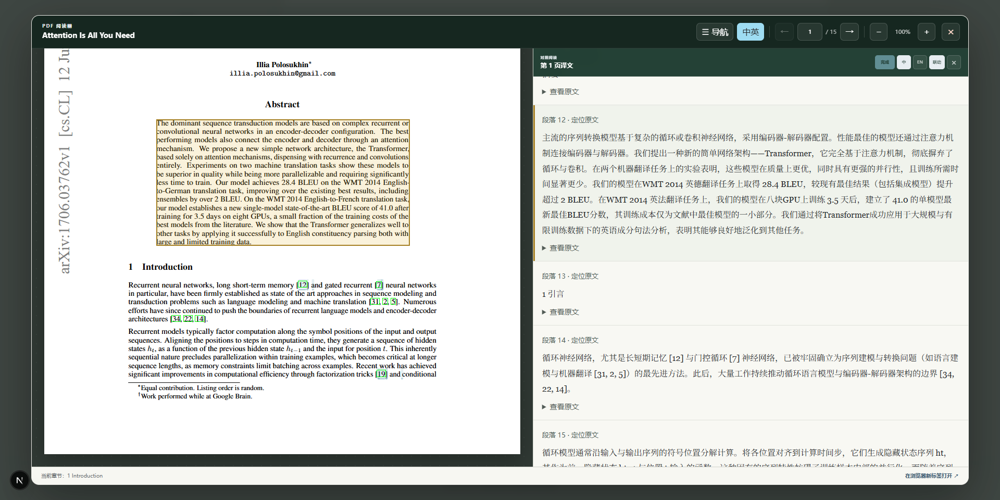

# 双语阅读与正式演示候选版

片尾修订：根据用户反馈，V2 删除片尾画面、配音与字幕中的复杂扫描公式及学术判断提示，章节标题改为“项目材料与代码”。其余十二章沿用 V1。新文件为 `output/video/paperpilot-subtitled-complete-neural-v2-2026-11-10.mp4` 及同名 SRT，384.12 秒（约 6 分 24 秒），全片解码及片尾画面检查通过。下文保留 V1 制作和项目验收记录。

本轮根据预指导反馈改进对照阅读，并补录此前只有入口或没有展示的操作。视频是正式提交候选版，未上传视频平台，也未替用户提交比赛。

## 阅读器

- 用译文 block_id 与原文 bbox 对应取代滚动百分比。译文按钮定位并高亮原文，原文块点击定位译文；滚动时选择对应块。
- 双栏页以点击选中的栏约束后续原文滚动匹配；首次未选栏时按最近块定位。该机制不是任意版式下完整阅读顺序的语义推断。
- 开启双语自动收起目录、原文适应栏宽，阅读器最大宽度由 1320 增至 1800px；修复内边距导致窗口缩小时溢出的问题。
- 译文默认 16px，可选 14／16／18／20px，原文详情 14px；删除正文常驻内部块编号，保留段落编号与定位入口。
- 无 bbox 的段落禁用定位按钮，仍可查看原文文字。显式点击定位在关闭自动联动后仍可使用。

## 验收范围

真实浏览器通过 Transformer v1 与 BERT 首页的译文定位、PDF 画布高亮、原文点击、字号调整和 1366／1920 宽度适应检查。BERT 覆盖左栏 p1-b2 和右栏 p1-b9（x=89.01／307.28）。Transformer 完成既有全文译文的 HTML 下载。没有重跑全 39 份 PDF 的全部翻译，也没有据此宣称所有扫描件均可准确联动。

另通过真实上传改名但内容完全相同 PDF 的识别、BERT／Transformer 跨文生成及两份原文打开、公开论文在线检索、LoRA／QLoRA 写作生成与复制。上传镜头是字节级去重，不冒充不同版本的语义去重演示。

本轮前端类型检查与 50 项测试通过（移除已废弃的百分比滚动单测），后端 1,779 项通过；修改 Python 文件 Ruff 和 Git diff 检查通过。浏览器首次遇到 Webpack／PDF.js 加载失败；隔离前端切换 Turbopack 后完成检查。Docker 基础镜像源返回 401，录制 API 使用既有镜像加当前源码，不据此声称全新服务器构建已通过。

## 写作修复与保留记录

研究主题和写作要求分开，避免操作指令进入摘要；旧 API 未填主题时明确保留待补。比较提示强调共同机制、差异及实验条件。修复写作前缀截断比较主体、产生空枚举的问题。复制失败现在显示提示。

首次真实写作将原文 more than 1,000 models 写成“少于 1,000 个模型”。该错误响应未用于新版视频；新增有限的模型数量方向检查，正反例四项通过。修复后的重新生成只保留两条机制陈述，核对共享冻结权重、低秩矩阵与 QLoRA 量化区别；不将它扩算为所有数值关系的通用语义验证。

## 视频

文件：`output/video/paperpilot-subtitled-complete-neural-v1-2026-11-10.mp4`，独立字幕同名 `.srt`。时长 388.58 秒（约 6 分 29 秒），1920×1080、25fps、H.264／AAC，内嵌中文字幕，约 26.8MB。

十三章依次为：介绍、上传、目录与引用、单篇问答、跨文比较、双语阅读、引用图谱、后续研究、CSV 图表、架构脚本、论文框架、实际检索、片尾。保留旧版已检查的真实录屏，替换双语并增加上传、跨文比较、写作和检索，不注入假响应。

配音使用 XiaoxiaoNeural，按整段合成，语速 -4%，直接使用语音服务句边界生成字幕，不再将每句本地语音加固定空白拼接。统一音量，测得峰值 -1.5dB；仍是合成配音。工具来源：[edge-tts](https://github.com/rany2/edge-tts)，仅用于媒体制作，未加入应用依赖。公开旁白是唯一发送给语音服务的文本。

全片解码通过，十三章逐章抽帧检查；字幕置于底部预留区域。未完成逐秒人工试听，最终使用前仍应主观确认配音听感。没有把合成、抽帧或单测数量算作论文回答正确率。

原始响应、失败录像、浏览器报告、配音时间轴和编码日志位于 `backend/tmp/demo-final-20261110/`。历史视频保留。公网、平台发布、复杂扫描公式、未覆盖版式的对照阅读与既有学术质量保留项继续单独追踪。
