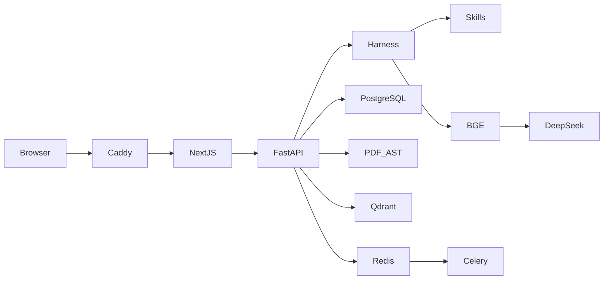
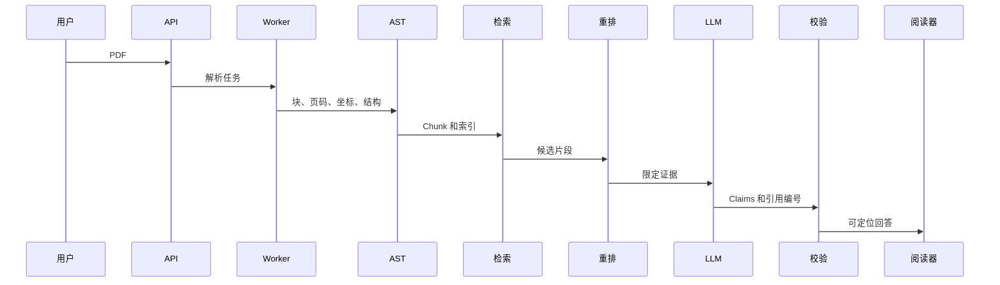

# PaperPilot：原文证据驱动的科研助手 Agent

技术内容核对版，2026-10-09。可复现代码基线：`8b888cf`（第 81 阶段），实际浏览器模型调用的后端代码为 `713fc94`；仓库：`https://github.com/Sana-114/PDF-AGENT`。本文与实现和保存的验收记录对照，不是“全部赛题通过”声明。公网、官方扫描原件与正式成片仍待完成；团队信息未提供，不虚构人员或上线地址。`main` 当前仍为第 67-70 阶段，后续阶段位于累积开发分支。

## 摘要

PaperPilot 将论文阅读、问答、翻译、引用关系和研究材料整理放在同一工作区。系统先把 PDF 解析为带页码、块编号和坐标的 Document AST，再检索相关片段供模型组织回答。前端呈现回答声明和原文出处，并提供 PDF 原页跳转。标准模式使用 BGE-M3、BGE Reranker 和已配置的 DeepSeek Flash；抽取式路径可以在不调用外部模型时整理原文。

系统覆盖六类比赛任务的主要流程，包含引用句作用筛选、Future Work 人工核验和本地录制路径。最新后端 284 项离线测试、前端 26 项测试、Ruff 和类型检查通过。七案例三轮的保存回答经 v6 等义词规则重新计分为 21/21；这是原回答内容验收，不是新增三轮调用。随后真实 Edge 浏览器一轮 7/7、17 条指定事实通过，并检查混合召回与重排；LayerNorm 两来源另行完成已绘制页图复查。解析公式是候选 LaTeX，OCR 专有名词、复杂表格和研究判断仍需人工核对。

关键词：科研助手；Document AST；RAG；证据定位；多文推理；局域引用图谱。

## 1. 项目概述与需求分析

### 1.1 使用场景

用户上传论文，检查版本和解析状态，在原始版式中阅读与翻译，围绕选定论文提问或比较方法，沿参考文献寻找后续阅读材料，再通过图谱、综述、写作框架和图表整理研究成果。系统的重点是减少用户在 PDF、搜索、对话和写作工具之间反复搬运上下文的成本。

### 1.2 比赛要求映射

| 模块 | 实现路径 | 验收边界 |
| --- | --- | --- |
| PDF 管理与解析 | 批量上传、CRUD、正文指纹、版本建议、OCR、结构节点、检查点 | 官方扫描件未复测；公式不是数学 OCR 真值 |
| 单篇／多篇问答 | BM25、向量召回、重排、DeepSeek、逐声明引用和拒答 | 固定七案例有内容与浏览器成绩，不等同开放域准确率 |
| 阅读与翻译 | PDF.js、目录、引用双向导航、划词、页级双语、同步滚动、Markdown／HTML | 作者年制自动链接尚未覆盖；原位 PDF 可选增强未实现 |
| 发现与推荐 | 题名／标识检索、安全导入、引用作用、arXiv 订阅、代码加分、反馈 | 引用作用是保守线索；多用户隔离未实现 |
| 图谱与综述 | 库内引用、局部 PageRank、证据综述、未来方向和人工记录 | 局部角色不是全领域影响力；人工作出是否解决的判断 |
| 写作与可视化 | 论文框架、真实来源书目、四种图脚本、CSV 图表和图注、学术翻译 | 不替代论文论证、统计检验或翻译审稿 |

### 1.3 非功能要求

长任务异步执行并可恢复；外部服务失败有明确降级和警告；密钥不进入前端、Git 或截图；运行配置、样本来源、测试规则与 Git 阶段可追溯。界面以问答、文献库、查找论文、研究脉络和研究产出五个入口组织六模块，避免把所有工具同时铺满首页。


## 2. 系统总体架构

### 2.1 分层设计



Next.js／React 负责交互和阅读；FastAPI 提供业务接口；Celery Worker／Beat 处理解析、翻译与订阅刷新；PostgreSQL 保存状态，文件卷保存 PDF／AST，Qdrant 保存向量。MinIO 配置作为基础设施保留，当前 PDF 上传实际使用本地命名卷存储，不把配置存在当成已接入对象存储。

图中的 Caddy 是已准备的公网方案，尚未在购置的公网服务器完成验收。本机演示直接使用前端 3300 和 API 8000，不能将它标成公网在线地址。

### 2.2 核心数据流



### 2.3 Agent Harness 与 Skills

Harness 是受业务流程约束的任务编排器，并非无限自治工具调用。Skill Registry 为概要、目录、表格、图表、公式、参考文献和证据检索定义结构化输入与输出。Trace 标识检索与生成路径；生成、证据门控和输出检查分离，便于发现是解析、检索还是模型回答出错。

## 3. PDF 管理与细粒度解析

### 3.1 路由与 AST

均匀抽样页面的文本密度区分原生、扫描、混合与空文档。PyMuPDF 保留页面文本、字体和坐标；低文本页选择性执行 Tesseract 中英文 OCR。统一 AST 包含标题、作者、机构、摘要、三级标题、页面块、表格、图区域、公式候选、参考文献与附录。后续工具共享这一解析结果。

### 3.2 版式和复杂内容

双栏阅读顺序依据几何位置重排；表格使用矢量网格或可信图注／列锚点；跨页表格合并要求相邻页、列边界一致和续表提示。扫描图区域采用受限栅格定位，不将整页扫描背景算作论文插图。公式保存原文本和 BBox，并进行明确数学符号的 LaTeX 规范化，不能保证复杂矩阵、分式和二维表达式完整还原。

### 3.3 版本处理

SHA-256 识别文件完全重复；arXiv ID、题名和正文指纹重合形成不同版本候选。提醒后由用户保留原版、替换或两版并存。AST 对比输出标题变化与可能新增／删除段落，并保留来源。此处正文指纹属于内容相似性方法，不是专门训练的版本语义差异模型。

### 3.4 长文档与恢复

默认每 25 页原子保存检查点，绑定文件 SHA、解析器版本和批大小。真实 541 页教材历史验收在 50 页模拟中断，恢复后第一个完成事件是第 75 页；最终 1,312,857 字，Python 分配峰值 45.11 MB、RSS 峰值 298.58 MB。该测试证明吞吐与恢复，不证明教材全部内容正确：当次教材表格抽取为零，复杂表格仍有缺口。

### 3.5 最新扫描结果

第 73 阶段的自制 15 页无文本层替代样本抽取 36,624 字、8 个姓名项和精确三家机构，耗时 87.308 秒、Python 分配峰值 49.09 MB。机构为 Google Brain、Google Research 和 University of Toronto。仍有 Lukasz 被 OCR 转录为 Fukasz 的字符错误，不能把姓名数量正确当成全部姓名准确。组委会同名扫描原件未取得；已有入库文档需重新解析才能采用新版解析器。

## 4. 抗幻觉问答与多文推理

### 4.1 检索与模型职责

BM25 补足精确术语；Qdrant Dense／Sparse 和融合召回候选；BGE Cross-Encoder 对有限候选重排。DeepSeek 负责组织已有证据、比较与生成语言表达，不作为事实数据库。第 81 阶段将第一阶段 `recall_mode` 与重排后的 `retrieval_mode` 分开记录：标准门禁要求 `hybrid` 召回、`reranked` 重排且中间查询无降级。只有重排标记不能证明向量召回执行，故障后的词法路径不记为完整标准模式成功。

### 4.2 声明、引用与定位

每轮证据重新编号，Claim 必须引用允许的编号。校验编号、结构与数值；EvidenceAnchor 保存文献、页码、块、BBox、摘录及召回来源。合法引用并不自动证明声明含义正确，因此还需金标核验和人工审校。SSE 先校验最终结果再渐进展示，不宣称直接透传上游 Token。原页验收还检查 Canvas 已有实际像素和文本层，不能只凭坐标覆盖层判定 PDF 内容已显示。

### 4.3 多文比较和拒答

每篇论文分别分配取证预算，避免长论文占满候选。枚举的比较维度独立检索；数值完整性检查避免已检出却漏写。某篇有证据但首轮未引用时，只用同一证据复核一次，仍单边则明确标记不足。GPU 型号／数量必须同时在所引原文和声明中得到支持；缺失信息不能拼成已回答，不把 TPU、层数或头数推成 GPU 配置，也不估算未报告的碳排放。该硬件规则偏保守，不保证识别所有 GPU 命名。

### 4.4 当前真实模型验收状态

2026-10-09 在获准的七篇公开论文摘录范围内执行了真实模型评测，并针对实际失败修复；没有发送私有论文或完整 PDF。v5 原始三轮后端代码为 `32514c3`，第 81 阶段实际浏览器后端为 `713fc94`；本文可复现基线 `8b888cf` 含后续页图门禁和验收记录，不是已冻结的提交 Tag。

| 记录 | 实际成绩 | 解释 |
| --- | --- | --- |
| 第 78 阶段 v3 三轮 | 17/21；拒答 3/6 | 发现 GPU 缺失信息被拼成已回答及词形误报 |
| 第 79 阶段 v4 三轮 | 20/21；拒答 6/6 | GPU 修复通过，仍出现单边 LayerNorm 回答 |
| 第 80 阶段 v5 三轮 | 20/21；事实 50/51 | 来源复核后，剩一项“子模块／子块”等义词误报 |
| 同一批 v5 回答按 v6 重新计分 | 21/21；事实 51/51；拒答 6/6 | 离线重查，不是新增三轮模型调用 |
| 第 81 阶段真实浏览器一轮 | 7/7；事实 17/17；拒答 2/2 | 新调用，核查混合召回＋重排＋生成与展示 |

v6 仅补充正确的等义表述，指定来源、页码、17 条事实和同一声明双来源要求不变；旧报告完整保留。v5 日志出现一次向量连接断开，原报告只检查重排，无法证明每次召回都是标准模式。第 81 阶段新增来源字段后，一轮浏览器严格通过，不能据此补写历史三轮召回字段或推断故障已根治。有限重试／补充会使 API 请求次数多于案例次数。

浏览器逐项比对真实 API 与可见回答，检查引用按钮到原页及拒答。初次截图存在尚未绘制的白页，所以只定向复查 LayerNorm：Transformer 第 2 页、GPT-2 第 4 页实际页图、文本层和高亮均通过，其他正向页图未按新增像素规则重跑。固定关键词匹配不等同全面语义正确性。


## 5. 版式阅读与双语翻译

PDF.js 原生展示页面，目录导航和百分比坐标覆盖层支持缩放后的证据定位。数字与真实字母书目标签可连接 References，返回点击位置或遍历上一／下一处引用；未知标签不生成链接。作者年制正文引用尚未实现完整自动双向链接。

划词／选段翻译保护公式、代码、引用和数字；页级译文按 Block ID 对齐，并提供可关闭的双向同步滚动。后台整篇翻译逐页缓存和续跑，输出 Markdown／自包含 HTML。比赛允许这些格式，DOCX 不属于当前功能；保持原位 PDF 仍是未实现的可选增强。逐页功能存在不等同整篇翻译质量已完成学术审校。


## 6. 论文发现、追踪与引用筛选

### 6.1 发现与安全导入

题名、DOI 和 arXiv 标识查询 Semantic Scholar、Crossref 与 arXiv。导入时后端重新解析来源，限制 HTTPS PDF 域名、重定向、体积及 PDF 文件头，避免任意地址下载。搜索匹配分反映书目身份，不代表论文质量。

### 6.2 引用正文作用

从实际引用偏移抽取所在句，保存页、块、BBox 和摘录。方法采用／扩展及实验基线优先；背景和未知不默认勾选；仅有泛指语境的条目在推荐模式暂不下钻，用户仍可按原顺序查看或显式选择。引用次数和题名匹配不能替代作用证据。这是保守规则筛选，不是对作者动机或“应付式引用”的事实判定，复合句和隐式引用可能误判或漏判。

### 6.3 arXiv 推荐

Celery Beat 定期刷新订阅，无需依赖 Sickle。排序结合本地相关度、时间、代码链接与点赞／踩反馈。搜索到的相关 GitHub 实现不自动冒充作者官方代码。当前共享文献库及评审门禁不是多用户数据隔离系统。

## 7. 引用图谱、综述与未来方向

### 7.1 局域拓扑

引用边按标识优先，再以规范题名等可解释匹配建立；保留参考条目和来源页。PageRank、入度等给出局部基石、桥接、衍生和孤立角色，不外推全领域影响力。本次界面为八节点文献库，不能当作二十篇真实图谱专项成绩。


### 7.2 Future Work 核验

Future Work 是论文提出的未来工作或未解决问题。系统提取相关段落，按较新论文的时间和主题证据提示可能进展，不自动宣称解决。方向 ID 绑定原文，记录继续探索、待核验及人工确认已有解决证据。确认需要更晚论文中的真实连续摘录、页码和块，拒绝同篇、旧年份或未知年份依据。

已确认方向不作为开放方向推荐，但原文和记录仍可查。重生成恢复判断，证据变更则不再据此排除。人工确认是研究者的判断，并非系统证明科学问题已解决；目前保留最新记录，没有多用户审计历史。联网搜索只能提供候选，须先导入并解析后核查原文。

### 7.3 原文整理模式

用户可以选择不调用 LLM，直接整理来源片段与未来方向；此模式明确显示 extractive。本地检查保存的是待核验流程记录，不是科学结论。生成式中文综述仍需要真实模型调用与审校。


## 8. 写作辅助与数据可视化

### 8.1 论文框架和真实 References

idea 与选定文献经检索后组织 Abstract、Introduction、Related Work。书目由 Document／PaperSource 重建，不采用模型自由编写的书目。缺失年份、作者或 DOI 等字段需提示，并不因此声称已拥有完整出版物信息。提出新论点和实验设计仍需研究者审查。

### 8.2 拓扑脚本

描述的节点与连线转为统一图结构，输出 Mermaid、Graphviz、TikZ 和 Matplotlib 四种脚本。预览和源码可编辑；这个确定性转换路径无需 LLM，也不保证所有第三方工具环境中的渲染效果。

### 8.3 CSV 图表与图注

检查编码、分隔符、列类型、缺失和非有限数值，支持表格、折线、柱状、聚合／误差棒、三维雷达和 SVG／Matplotlib 输出。Caption 只描述实际统计趋势，不推断因果或显著性。雷达透视层高区分记录，不增添数据维度；示例三种方法的数值是界面演示数据，不是项目模型准确率。


### 8.4 学术翻译

中英翻译支持术语表、代码／公式／数字保护和审校草稿。模型负责学术语言表达，不能取代领域专家；长篇译文、术语一致性和特殊版式仍需人工抽检。

## 9. AI 选型、集成与优化

| 技术 | 本项目作用 | 集成与降级 |
| --- | --- | --- |
| PyMuPDF／Tesseract | 保留几何位置，补充低文本页 OCR | Parser 接口统一 AST，缺包明确报错 |
| BGE-M3 | 语义 embedding 召回 | TEI 接口，本地模型缓存，不入 Git |
| BGE Reranker v2 M3 | 问题与候选片段联合重排 | 有限微批，失败标记非标准检索 |
| Qdrant／BM25 | 语义与精确召回 | 模型签名隔离向量库，故障降级可辨识 |
| DeepSeek Flash | 证据回答、语言组织和翻译 | Provider 适配、结构解析、有限重试／抽取式降级 |
| Harness／Schema | 约束工具、声明和引用 | Trace、白名单及数值审计，可定位失败阶段 |

选型依据是证据可定位、中文提问／英文论文混合检索和可替换部署。PyMuPDF 保留页面几何，Tesseract 提供不依赖外部图像 API 的低文本页 OCR；代价是复杂公式与专有名词质量有限。BGE-M3 与 Cross-Encoder 将召回、候选排序分离，BM25 保留精确术语匹配；选择本地服务避免将整个索引发送外部，但需要额外模型缓存和内存，不能声称优于所有其他模型。

DeepSeek 通过已有 Provider 的 Responses 接口组织有限证据，客户端只提交业务请求，Key 留在后端。它避免自行部署生成模型，却带来外发授权、网络可用性及调用费用约束。相同接口提供抽取式降级；降级可用性和真实生成质量分别验收，不用流畅程度代替事实正确性。

优化包括按页检查点、低文本页 OCR、受限重型表格分析、Embedding 批量、Reranker 微批、缓存译文和按论文预算取证。CPU／GPU 标准模式与 Lite 模式区分部署成本；不把 Lite 的确定性向量当成 BGE 语义质量。新功能的规则与人工决策不必调用 LLM，有助于成本、延迟和来源核对。

## 10. 测试、证据与复现

### 10.1 分层成绩

| 日期／阶段 | 验证项 | 结果与局限 |
| --- | --- | --- |
| 9 月，第 65 阶段 | v7→v1、真实 541 页教材 | 各 8/8 工程检查；不代表全部抽取质量 |
| 9 月，第 66 阶段 | 历史五案例模型与浏览器 | 后端三轮 15/15；浏览器两轮各 5/5、14 事实 |
| 10 月，第 73 阶段 | 六篇原生、扫描替代样本 | 原生 144 页 6/6；扫描三家机构精确，仍有姓名错字 |
| 10 月，第 76 阶段 | 离线回归与前端 | 后端 239；前端 20；Ruff、类型与生产构建通过 |
| 10 月，第 76 阶段 | 本地真实浏览器录制路径 | 六场景截图、无页面异常；不调用外部模型 |
| 10 月，第 80 阶段 | 七案例三轮保存回答 v6 重新计分 | 21/21、51/51 事实、6/6 拒答；不是新增三轮调用 |
| 10 月，第 81 阶段 | 严格召回来源＋真实浏览器 | 一轮 7/7、17/17 事实；两原页另行定向像素检查 |
| 10 月，第 81 阶段 | 最新离线回归 | 后端 284、前端 26、Ruff 和类型检查通过 |

### 10.2 可复现原则

源 PDF 清单记录来源与 SHA，金标要求指定来源与页码。缺少案例、模型改变和不安全拒答不计稳定通过。评测等义词修正升级数据集版本；重新计分报告保存原文件 SHA 与成绩，不冒充新调用。机器 JSON、模型答案及下载 PDF 位于忽略目录，公开仓库保存脚本、规则、截图与验收说明。截图均为实际页面返回，没有合成回答或替换 API 数据。

### 10.3 复现命令

```powershell
# 在 frontend 目录，复现不调用外部 LLM 的页面检查
node e2e/recordingReadiness.mjs
# 明确授权公开论文摘录外发、配置有效 Key 后再运行
pwsh -File scripts/run_real_pdf_comparison_e2e.ps1 -Gpu -Rounds 3
```

第二条在仓库根目录运行；当前脚本已加入严格召回来源要求，未来复跑不可等同历史仅检查重排的成绩。若已有通过的同版后端报告，可直接运行 `frontend/e2e/realPdfComparison.mjs`，不必自动再调用三轮模型；参数与新输出目录见第 81 阶段说明。完整离线测试使用后端开发依赖及中英文 OCR 语言包。自动门禁是固定样本工程检查，不是任意问题正确性的证明。

## 11. 部署、安全与交付

### 11.1 本地运行

Docker Desktop 启动后，仓库根目录执行 `scripts/start.ps1 -Mode standard -Gpu`，无 NVIDIA 环境移除 GPU 选项；Lite 使用 `-Mode lite`。本机当前前端 3300、API 8000。启动检查区分端口占用／Windows 保留端口；停止默认保留数据卷。先恢复数据库／队列依赖再诊断后端，不能仅因前端容器健康就认定全链路正常。

### 11.2 公网方案保持不变

生产 Compose、Caddy HTTPS、评审门禁、备份和外网检查脚本已准备。临近提交再购置服务器与域名，配置 DNS、仅开放必要端口，使用新 Key 和随机密码部署，并从另一网络验证上传、解析、问答、原页跳转和拒答。当前没有公网地址或线上验收成绩。

### 11.3 敏感数据和最终材料

环境文件不入 Git，模型权重保存在命名卷。聊天中暴露过的 Key 应撤销并重新生成。LLM 会将检索摘录发送到配置的模型服务，应获得授权并避免私有文献外发。本次真实验收获准发送仅七篇公开论文的检索摘录与固定问题，没有扩大授权为私有文献或任意任务。提交前补齐真实团队信息、Public／评审权限、正式 Tag、≤30 页 PDF、5-8 分钟 1080p MP4、公网 URL 与体验方式，再冻结材料哈希。

## 12. 创新点、总结与展望

### 12.1 技术与应用创新

技术创新：贯穿解析、检索、声明和阅读的证据坐标；召回来源与重排分离验收；按论文和维度公平取证；已检出数值与来源完整性的有限复核；长文档原子检查点；模型生成书目与真实元数据解耦。这些是本项目的集成设计，不宣称提出了新的基础模型算法。

应用创新：将引用身份匹配和正文作用分开，为下钻阅读提供可解释筛选；将 Future Work 原文、较新进展和人工判断保存在同一证据流程；以比较声明到双来源原页的跳转连接阅读和研究材料，让用户可检查依据和限制。

### 12.2 未覆盖的核心边界

官方扫描原件、OCR 姓名字符、复杂数学和教材表格仍有缺口；作者年制引用导航、应用级多用户隔离尚未完成；引用作用规则可能漏判，人工确认不是自动科研证明。新版七案例内容及一轮严格浏览器链路已有成绩，但不能替代整篇翻译、生成式综述和新 idea 论证的学术审校，也未完成二十篇真实图谱专项。清洁环境启动、公网、正式视频及最终 Tag 仍待完成，不能声明比赛全部验收通过。

### 12.3 有限收尾顺序

先录已核验的本地比较、拒答、原页跳转和确定性工具；对翻译、生成式写作／综述只做录制所需的有限人工审校与缺口修复；在获得官方数据和公网环境后分别复测。当前 main 仍为 `f20b6eb`（第 67-70 阶段），最新版在累积阶段分支，正式克隆验收前需合并通过的阶段。临近提交购置服务器、部署并补录门禁／URL，登记真实团队、发布版本和材料哈希后冻结。不无限扩大测试集，不在缺少结果时填写通过数字。

## 13. 验收资料索引

所有路径相对仓库根目录。机器结果与 PDF 下载文件不进入 Git；以下说明保存复现入口、验收条件和实际结果。

| 用途 | 仓库文件 |
| --- | --- |
| 安装与架构 | README.md；docs/architecture.md |
| 公网部署方案 | docs/public-deployment.md |
| 历史核心门禁 | docs/release-core-gate-acceptance-2026-09-27.md |
| 历史数值完整性 | docs/numeric-fact-completeness-acceptance-2026-09-27.md |
| 扫描机构元数据 | docs/scanned-metadata-acceptance-2026-10-08.md |
| 引用正文作用 | docs/citation-context-acceptance-2026-10-08.md |
| Future Work 人工核验 | docs/future-work-review-acceptance-2026-10-08.md |
| 本地录制路径 | docs/recording-readiness-acceptance-2026-10-08.md |
| 真实模型失败基线 | docs/real-model-baseline-acceptance-2026-10-09.md |
| GPU 拒答修复 | docs/grounded-gpu-refusal-acceptance-2026-10-09.md |
| 来源完整性与重新计分 | docs/comparison-coverage-acceptance-2026-10-09.md |
| 严格浏览器链路 | docs/retrieval-provenance-acceptance-2026-10-09.md |
| 交付清单 | docs/competition-delivery-checklist.md |
| 视频分镜与解说 | docs/demo-video-script.md |

本报告记录项目实现，不将截图中论文内容当作作者原创成果。公开论文来源与哈希详见 `docs/pdf-regression-corpus.json`；原始论文权利归各作者／出版方，下载文件不随项目代码提交。
